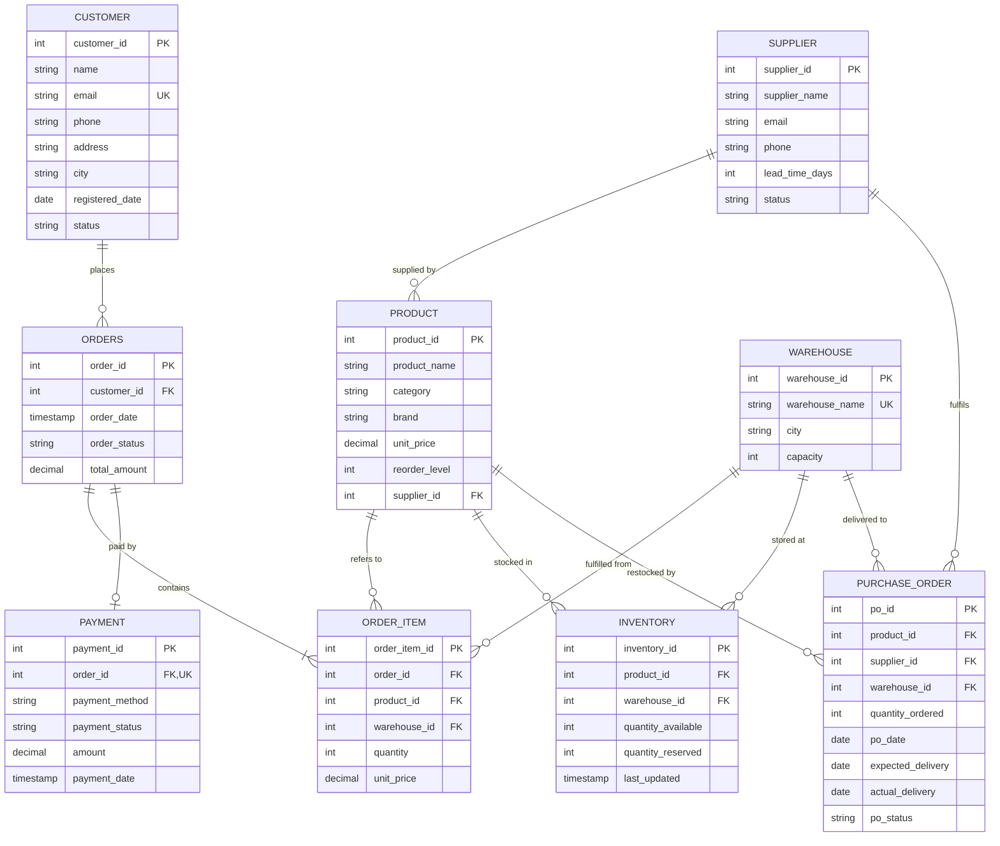

# ER diagram and relational schema

Same design as Review I (9 entities, 11 relationships, 3NF).

PRODUCT and WAREHOUSE are many-to-many; INVENTORY resolves it (UNIQUE on product_id + warehouse_id).
The full constraint list is in `sql/01_schema.sql`.
