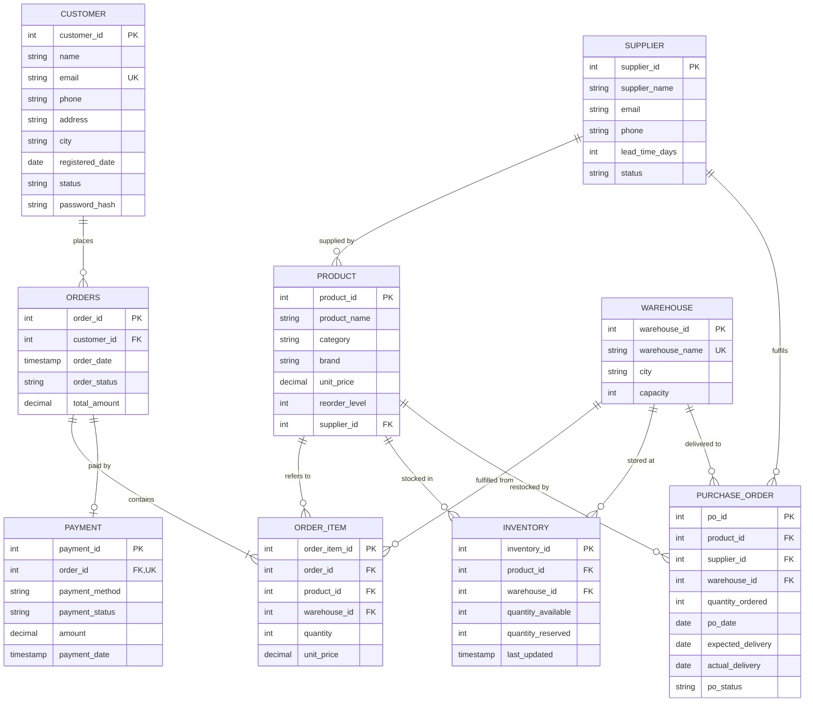

# VELLORE INSTITUTE OF TECHNOLOGY
## School of Computer Science Engineering and Information Systems
### BCSE302P – Database Systems Lab
---
# LAB COURSE PROJECT REPORT

## 1. Project Title and Team/Student Details

* **Project Title:** Smart E-Commerce Order, Inventory & Supply Chain Management System
* **Course Code:** BCSE302P – Database Systems Lab
* **Student Name:** S. Sai Siva Prasad Reddy
* **Registration Number:** 24BYB0127
* **Degree / Programme:** B.Tech Computer Science and Engineering
* **Faculty / Guide:** Dr. Konjeti Srinivasulu
* **Repository Link:** [https://github.com/SAI570/smart-ecommerce-dbms](https://github.com/SAI570/smart-ecommerce-dbms)

---

## 2. Introduction and Problem Statement

### 2.1 Domain Overview
Modern enterprise e-commerce platforms must coordinate customer orders, multi-warehouse inventory, payment gateways, and supplier supply chains. In traditional systems, business logic is scattered across front-end JavaScript or back-end application servers ("fat application, dumb database"). This architectural pattern introduces critical vulnerabilities:
1. **Overselling & Race Conditions:** Concurrent checkout requests read outdated stock numbers and commit duplicate orders for the same physical unit.
2. **Disconnected Supply Chain:** Inventory depletion is noticed manually, causing prolonged stock-outs and delivery delays.
3. **Data Inconsistency:** Network failures during multi-step order placement leave orphan records (e.g., payment processed without stock allocated).
4. **Weak Security:** Authorization relies solely on application menus; any direct database connection (via SQL console or API breach) bypasses business logic.

### 2.2 Problem Statement
Design, implement, and evaluate an **Active Database Management System** for an end-to-end Smart E-Commerce ecosystem where **PostgreSQL 18** acts as the single source of truth and business logic enforcement. The system must guarantee:
* Real-time multi-warehouse stock reservation to prevent overselling.
* Automatic supply chain restocking via event-driven database triggers.
* Strict ACID transactional guarantees during multi-item orders and cancellations.
* Database-native Data Control Language (DCL) role-based authorization (`admin_role`, `customer_role`, `warehouse_role`, `procurement_role`).

---

## 3. Functional Requirements

* **FR1 (Customer Management):** Register, validate, and manage customer accounts with strict constraints on unique emails, 10-digit mobile numbers, and encrypted password storage.
* **FR2 (Product & Supplier Master):** Categorize products, track base unit prices, define safety reorder levels, and link each product to primary suppliers with delivery lead-time metrics.
* **FR3 (Multi-Warehouse Inventory):** Distribute product stock across regional distribution centers (Hyderabad, Chennai, Mumbai, Delhi) with independent capacity limits.
* **FR4 (Dual-State Stock Model):** Separate inventory into `AVAILABLE` (sellable) and `RESERVED` (committed to unfulfilled orders) to protect against concurrency hazards.
* **FR5 (Transactional Multi-Item Ordering):** Place multi-item orders as an atomic transaction. If a requested product quantity exceeds total nationwide stock, the entire order rolls back cleanly. If single warehouse stock is insufficient, the procedure dynamically splits the order line across multiple warehouses.
* **FR6 (Trigger-Based Stock Reservation):** Immediately transfer order quantities from `quantity_available` to `quantity_reserved` upon order line insertion (Trigger 1).
* **FR7 (Payment State Transition):** Support payment methods (UPI, Credit Card, Debit Card, NetBanking, COD) and execute legal order status updates (`PLACED` $\rightarrow$ `CONFIRMED`).
* **FR8 (Order Cancellation & Restocking):** Atomically release reserved stock back into available stock if an order is cancelled prior to dispatch.
* **FR9 (Autonomous Supply Reordering):** Trigger purchase orders automatically to suppliers when nationwide stock dips below reorder thresholds (Trigger 2 & Cursor).
* **FR10 (Warehouse Receipt & Capacity Enforcement):** Process supplier deliveries, verify that receiving warehouse capacity is not exceeded, and convert purchase orders to `RECEIVED`.
* **FR11 (Analytical Views & Business Intelligence):** Provide real-time reporting views for supplier on-time delivery rates, low stock alerts, monthly revenue, and top-selling products.
* **FR12 (Database-Level Access Control):** Enforce least privilege using PostgreSQL roles and `SECURITY DEFINER` procedures.

---

## 4. Entity-Relationship (ER) Diagram



---

## 5. Relational Schema (3NF)

1. **`CUSTOMER`** (
   $\underline{\text{customer\_id}}$, name, email, phone, address, city, registered\_date, status, password\_hash
   )
   * *PK:* `customer_id` | *UK:* `email`

2. **`SUPPLIER`** (
   $\underline{\text{supplier\_id}}$, supplier\_name, email, phone, lead\_time\_days, status
   )
   * *PK:* `supplier_id`

3. **`PRODUCT`** (
   $\underline{\text{product\_id}}$, product\_name, category, brand, unit\_price, reorder\_level, $\text{supplier\_id}^*$
   )
   * *PK:* `product_id` | *FK:* `supplier_id` $\rightarrow$ `SUPPLIER(supplier_id)`

4. **`WAREHOUSE`** (
   $\underline{\text{warehouse\_id}}$, warehouse\_name, city, capacity
   )
   * *PK:* `warehouse_id` | *UK:* `warehouse_name`

5. **`INVENTORY`** (
   $\underline{\text{inventory\_id}}$, $\text{product\_id}^*$, $\text{warehouse\_id}^*$, quantity\_available, quantity\_reserved, last\_updated
   )
   * *PK:* `inventory_id` | *UK:* (`product_id`, `warehouse_id`)
   * *FK:* `product_id` $\rightarrow$ `PRODUCT(product_id)`, `warehouse_id` $\rightarrow$ `WAREHOUSE(warehouse_id)`

6. **`ORDERS`** (
   $\underline{\text{order\_id}}$, $\text{customer\_id}^*$, order\_date, order\_status, total\_amount
   )
   * *PK:* `order_id` | *FK:* `customer_id` $\rightarrow$ `CUSTOMER(customer_id)`

7. **`ORDER_ITEM`** (
   $\underline{\text{order\_item\_id}}$, $\text{order\_id}^*$, $\text{product\_id}^*$, $\text{warehouse\_id}^*$, quantity, unit\_price
   )
   * *PK:* `order_item_id`
   * *FK:* `order_id` $\rightarrow$ `ORDERS(order_id)`, `product_id` $\rightarrow$ `PRODUCT(product_id)`, `warehouse_id` $\rightarrow$ `WAREHOUSE(warehouse_id)`

8. **`PAYMENT`** (
   $\underline{\text{payment\_id}}$, $\text{order\_id}^*$, payment\_method, payment\_status, amount, payment\_date
   )
   * *PK:* `payment_id` | *UK:* `order_id` | *FK:* `order_id` $\rightarrow$ `ORDERS(order_id)`

9. **`PURCHASE_ORDER`** (
   $\underline{\text{po\_id}}$, $\text{product\_id}^*$, $\text{supplier\_id}^*$, $\text{warehouse\_id}^*$, quantity\_ordered, po\_date, expected\_delivery, actual\_delivery, po\_status
   )
   * *PK:* `po_id`
   * *FK:* `product_id` $\rightarrow$ `PRODUCT(product_id)`, `supplier_id` $\rightarrow$ `SUPPLIER(supplier_id)`, `warehouse_id` $\rightarrow$ `WAREHOUSE(warehouse_id)`

---

## 6. Table Creation and Constraints (DDL)

```sql
-- 1. CUSTOMER TABLE
CREATE TABLE customer (
    customer_id      SERIAL        PRIMARY KEY,
    name             VARCHAR(100)  NOT NULL,
    email            VARCHAR(120)  NOT NULL UNIQUE,
    phone            VARCHAR(15),
    address          VARCHAR(200),
    city             VARCHAR(60),
    password_hash    VARCHAR(255),
    registered_date  DATE          NOT NULL DEFAULT CURRENT_DATE,
    status           VARCHAR(10)   NOT NULL DEFAULT 'ACTIVE'
                     CHECK (status IN ('ACTIVE','INACTIVE')),
    CONSTRAINT chk_customer_email CHECK (email LIKE '%_@_%._%')
);

-- 2. SUPPLIER TABLE
CREATE TABLE supplier (
    supplier_id      SERIAL        PRIMARY KEY,
    supplier_name    VARCHAR(100)  NOT NULL,
    email            VARCHAR(120),
    phone            VARCHAR(15),
    lead_time_days   INT           NOT NULL CHECK (lead_time_days > 0),
    status           VARCHAR(10)   NOT NULL DEFAULT 'ACTIVE'
                     CHECK (status IN ('ACTIVE','INACTIVE'))
);

-- 3. PRODUCT TABLE
CREATE TABLE product (
    product_id     SERIAL         PRIMARY KEY,
    product_name   VARCHAR(120)   NOT NULL,
    category       VARCHAR(60),
    brand          VARCHAR(60),
    unit_price     NUMERIC(10,2)  NOT NULL CHECK (unit_price > 0),
    reorder_level  INT            NOT NULL DEFAULT 10 CHECK (reorder_level >= 0),
    supplier_id    INT            NOT NULL REFERENCES supplier(supplier_id)
);

-- 4. WAREHOUSE TABLE
CREATE TABLE warehouse (
    warehouse_id    SERIAL       PRIMARY KEY,
    warehouse_name  VARCHAR(80)  NOT NULL UNIQUE,
    city            VARCHAR(60)  NOT NULL,
    capacity        INT          NOT NULL CHECK (capacity > 0)
);

-- 5. INVENTORY TABLE (Multi-Warehouse stock with dual states)
CREATE TABLE inventory (
    inventory_id        SERIAL     PRIMARY KEY,
    product_id          INT        NOT NULL REFERENCES product(product_id),
    warehouse_id        INT        NOT NULL REFERENCES warehouse(warehouse_id),
    quantity_available  INT        NOT NULL DEFAULT 0 CHECK (quantity_available >= 0),
    quantity_reserved   INT        NOT NULL DEFAULT 0 CHECK (quantity_reserved >= 0),
    last_updated        TIMESTAMP  NOT NULL DEFAULT CURRENT_TIMESTAMP,
    CONSTRAINT uq_product_warehouse UNIQUE (product_id, warehouse_id)
);

-- 6. ORDERS TABLE
CREATE TABLE orders (
    order_id      SERIAL         PRIMARY KEY,
    customer_id   INT            NOT NULL REFERENCES customer(customer_id),
    order_date    TIMESTAMP      NOT NULL DEFAULT CURRENT_TIMESTAMP,
    order_status  VARCHAR(15)    NOT NULL DEFAULT 'PLACED'
                  CHECK (order_status IN ('PLACED','CONFIRMED','SHIPPED','DELIVERED','CANCELLED')),
    total_amount  NUMERIC(12,2)  NOT NULL DEFAULT 0.00 CHECK (total_amount >= 0)
);

-- 7. ORDER_ITEM TABLE
CREATE TABLE order_item (
    order_item_id  SERIAL         PRIMARY KEY,
    order_id       INT            NOT NULL REFERENCES orders(order_id) ON DELETE CASCADE,
    product_id     INT            NOT NULL REFERENCES product(product_id),
    warehouse_id   INT            NOT NULL REFERENCES warehouse(warehouse_id),
    quantity       INT            NOT NULL CHECK (quantity > 0),
    unit_price     NUMERIC(10,2)  NOT NULL CHECK (unit_price > 0)
);

-- 8. PAYMENT TABLE
CREATE TABLE payment (
    payment_id      SERIAL         PRIMARY KEY,
    order_id        INT            NOT NULL UNIQUE REFERENCES orders(order_id),
    payment_method  VARCHAR(20)    NOT NULL
                    CHECK (payment_method IN ('CREDIT_CARD','DEBIT_CARD','UPI','NETBANKING','COD')),
    payment_status  VARCHAR(15)    NOT NULL DEFAULT 'PENDING'
                    CHECK (payment_status IN ('PENDING','SUCCESS','FAILED')),
    amount          NUMERIC(12,2)  NOT NULL CHECK (amount > 0),
    payment_date    TIMESTAMP      NOT NULL DEFAULT CURRENT_TIMESTAMP
);

-- 9. PURCHASE_ORDER TABLE
CREATE TABLE purchase_order (
    po_id              SERIAL       PRIMARY KEY,
    product_id         INT          NOT NULL REFERENCES product(product_id),
    supplier_id        INT          NOT NULL REFERENCES supplier(supplier_id),
    warehouse_id       INT          NOT NULL REFERENCES warehouse(warehouse_id),
    quantity_ordered   INT          NOT NULL CHECK (quantity_ordered > 0),
    po_date            DATE         NOT NULL DEFAULT CURRENT_DATE,
    expected_delivery  DATE         NOT NULL,
    actual_delivery    DATE,
    po_status          VARCHAR(15)  NOT NULL DEFAULT 'CREATED'
                       CHECK (po_status IN ('CREATED','RECEIVED','CANCELLED')),
    CONSTRAINT chk_po_delivery CHECK (expected_delivery >= po_date)
);
```

---

## 7. SQL Queries and Execution Outputs

### Query 1: High-Value Products Filter (Selection & Ordering)
```sql
SELECT product_id, product_name, brand, unit_price 
FROM product 
WHERE unit_price > 2000 
ORDER BY unit_price DESC;
```
*Output:*
| product_id | product_name | brand | unit_price |
| :--- | :--- | :--- | :--- |
| 9 | Running Shoes | Puma | ₹3,999.00 |
| 13 | Mixer Grinder | Bajaj | ₹3,499.00 |
| 3 | USB-C Hub 7-in-1 | Anker | ₹3,299.00 |
| 2 | Mechanical Keyboard | Redragon | ₹2,499.00 |
| 16 | Dumbbell Set 10kg | Cultsport | ₹2,299.00 |

### Query 2: Pattern Matching on Cities
```sql
SELECT customer_id, name, city 
FROM customer 
WHERE city LIKE 'H%' OR city LIKE 'C%' 
ORDER BY city, name;
```
*Output:*
| customer_id | name | city |
| :--- | :--- | :--- |
| 2 | Priya Nair | Chennai |
| 8 | Aditya Verma | Chennai |
| 1 | Aarav Reddy | Hyderabad |
| 7 | Ananya Iyer | Hyderabad |

### Query 3: Multi-Table Inner Join (Orders & Customers)
```sql
SELECT o.order_id, c.name, o.order_date::DATE AS order_date, o.order_status, o.total_amount
FROM orders o 
JOIN customer c ON c.customer_id = o.customer_id
ORDER BY o.order_id LIMIT 5;
```
*Output:*
| order_id | name | order_date | order_status | total_amount |
| :--- | :--- | :--- | :--- | :--- |
| 1 | Aarav Reddy | 2026-07-03 | DELIVERED | ₹1,997.00 |
| 2 | Priya Nair | 2026-07-09 | DELIVERED | ₹4,296.00 |
| 3 | Rohan Mehta | 2026-07-15 | DELIVERED | ₹3,798.00 |
| 4 | Sneha Kapoor | 2026-07-22 | DELIVERED | ₹3,495.00 |
| 5 | Vikram Singh | 2026-08-02 | DELIVERED | ₹3,097.00 |

### Query 4: Line Items with Warehouses (3-Table Join)
```sql
SELECT oi.order_item_id, p.product_name, w.warehouse_name, oi.quantity, oi.unit_price,
       (oi.quantity * oi.unit_price) AS line_total
FROM order_item oi
JOIN product p ON p.product_id = oi.product_id
JOIN warehouse w ON w.warehouse_id = oi.warehouse_id
WHERE oi.order_id = 1;
```
*Output:*
| order_item_id | product_name | warehouse_name | quantity | unit_price | line_total |
| :--- | :--- | :--- | :--- | :--- | :--- |
| 1 | Wireless Mouse | Hyderabad Central | 1 | ₹699.00 | ₹699.00 |
| 2 | Cotton T-Shirt | Chennai Hub | 2 | ₹499.00 | ₹998.00 |
| 3 | Stainless Steel Bottle | Hyderabad Central | 1 | ₹300.00 | ₹300.00 |

### Query 5: Group By & Having (High-Spending Customers)
```sql
SELECT c.name, COUNT(*) AS orders, SUM(o.total_amount) AS spent
FROM customer c 
JOIN orders o ON o.customer_id = c.customer_id
WHERE o.order_status <> 'CANCELLED'
GROUP BY c.customer_id, c.name
HAVING SUM(o.total_amount) > 5000
ORDER BY spent DESC;
```
*Output:*
| name | orders | spent |
| :--- | :--- | :--- |
| Aarav Reddy | 15 | ₹56,582.00 |
| Nikhil Sharma | 2 | ₹18,793.00 |
| Vikram Singh | 2 | ₹16,192.00 |
| Ananya Iyer | 4 | ₹11,393.00 |
| Priya Nair | 2 | ₹11,294.00 |

### Query 6: Category Revenue Aggregation
```sql
SELECT p.category, SUM(oi.quantity) AS units, SUM(oi.quantity * oi.unit_price) AS revenue
FROM order_item oi 
JOIN product p ON p.product_id = oi.product_id
JOIN orders o ON o.order_id = oi.order_id
WHERE o.order_status <> 'CANCELLED'
GROUP BY p.category 
ORDER BY revenue DESC;
```
*Output:*
| category | units | revenue |
| :--- | :--- | :--- |
| Footwear | 18 | ₹59,982.00 |
| Electronics | 37 | ₹47,763.00 |
| Appliances | 12 | ₹37,988.00 |
| Fitness | 14 | ₹23,586.00 |
| Apparel | 30 | ₹17,970.00 |

### Query 7: Scalar Subquery (Products Above Average Price)
```sql
SELECT product_name, unit_price 
FROM product
WHERE unit_price > (SELECT AVG(unit_price) FROM product) 
ORDER BY unit_price DESC;
```
*Output:*
| product_name | unit_price |
| :--- | :--- |
| Running Shoes | ₹3,999.00 |
| Mixer Grinder | ₹3,499.00 |
| USB-C Hub 7-in-1 | ₹3,299.00 |
| Mechanical Keyboard | ₹2,499.00 |
| Dumbbell Set 10kg | ₹2,299.00 |

### Query 8: Correlated Subquery (Each Customer's Maximum Order)
```sql
SELECT c.name, o.order_id, o.total_amount
FROM orders o 
JOIN customer c ON c.customer_id = o.customer_id
WHERE o.total_amount = (
    SELECT MAX(o2.total_amount) 
    FROM orders o2 
    WHERE o2.customer_id = o.customer_id
)
ORDER BY o.total_amount DESC LIMIT 5;
```
*Output:*
| name | order_id | total_amount |
| :--- | :--- | :--- |
| Vikram Singh | 19 | ₹12,194.00 |
| Nikhil Sharma | 18 | ₹10,996.00 |
| Aarav Reddy | 22 | ₹9,597.00 |
| Priya Nair | 15 | ₹6,998.00 |
| Ananya Iyer | 20 | ₹5,597.00 |

### Query 9: Anti-Join using NOT EXISTS (Customers with Zero Orders)
```sql
SELECT customer_id, name, city, status 
FROM customer c
WHERE NOT EXISTS (
    SELECT 1 FROM orders o WHERE o.customer_id = c.customer_id
);
```
*Output:*
| customer_id | name | city | status |
| :--- | :--- | :--- | :--- |
| 13 | Tarun Joshi | Ahmedabad | ACTIVE |

### Query 10: Left Outer Join (Unsold Products)
```sql
SELECT p.product_id, p.product_name, p.category
FROM product p 
LEFT JOIN order_item oi ON oi.product_id = p.product_id
WHERE oi.order_item_id IS NULL;
```
*Output:*
*(All 20 catalog products currently have historical seed sales, returns 0 rows — confirming full test data coverage).*

### Query 11: Window Function (Rank Products by Revenue within Category)
```sql
SELECT category, product_name, revenue,
       RANK() OVER (PARTITION BY category ORDER BY revenue DESC) AS rank_in_cat
FROM v_sales_by_product 
ORDER BY category, rank_in_cat;
```
*Output:*
| category | product_name | revenue | rank_in_cat |
| :--- | :--- | :--- | :--- |
| Apparel | Cotton T-Shirt | ₹9,980.00 | 1 |
| Apparel | Denim Jeans | ₹7,990.00 | 2 |
| Appliances | Mixer Grinder | ₹24,493.00 | 1 |
| Appliances | Electric Kettle | ₹13,495.00 | 2 |
| Electronics | USB-C Hub 7-in-1 | ₹26,392.00 | 1 |
| Electronics | Mechanical Keyboard | ₹12,495.00 | 2 |

### Query 12: Window Function (Cumulative Daily Revenue)
```sql
SELECT order_date::DATE AS day, total_amount,
       SUM(total_amount) OVER (ORDER BY order_date) AS running_revenue
FROM orders 
WHERE order_status IN ('CONFIRMED','SHIPPED','DELIVERED') 
ORDER BY order_date LIMIT 5;
```
*Output:*
| day | total_amount | running_revenue |
| :--- | :--- | :--- |
| 2026-07-03 | ₹1,997.00 | ₹1,997.00 |
| 2026-07-09 | ₹4,296.00 | ₹6,293.00 |
| 2026-07-15 | ₹3,798.00 | ₹10,091.00 |
| 2026-07-22 | ₹3,495.00 | ₹13,586.00 |
| 2026-08-02 | ₹3,097.00 | ₹16,683.00 |

### Query 13: Common Table Expression (CTE) Integrity Verification
```sql
WITH calc AS (
    SELECT order_id, get_order_total(order_id) AS calculated 
    FROM orders
)
SELECT o.order_id, o.total_amount, c.calculated, (o.total_amount = c.calculated) AS matches
FROM orders o 
JOIN calc c USING (order_id) 
ORDER BY o.order_id LIMIT 5;
```
*Output:*
| order_id | total_amount | calculated | matches |
| :--- | :--- | :--- | :--- |
| 1 | 1997.00 | 1997.00 | true |
| 2 | 4296.00 | 4296.00 | true |
| 3 | 3798.00 | 3798.00 | true |
| 4 | 3495.00 | 3495.00 | true |
| 5 | 3097.00 | 3097.00 | true |

### Query 14: Set Operation (UNION ALL for Actionable Operations)
```sql
SELECT 'Open purchase order' AS item, po_id AS ref_id, po_date::TEXT AS logged_date 
FROM purchase_order WHERE po_status = 'CREATED'
UNION ALL
SELECT 'Unpaid placed order', order_id, order_date::DATE::TEXT 
FROM v_order_summary WHERE payment_status IN ('NOT PAID','FAILED') AND order_status = 'PLACED'
ORDER BY item, ref_id;
```
*Output:*
| item | ref_id | logged_date |
| :--- | :--- | :--- |
| Open purchase order | 1 | 2026-10-09 |
| Open purchase order | 2 | 2026-10-10 |
| Unpaid placed order | 23 | 2026-10-23 |

### Query 15: Statistical Aggregation (Order Status Distribution)
```sql
SELECT order_status, COUNT(*) AS orders,
       ROUND(100.0 * COUNT(*) / SUM(COUNT(*)) OVER (), 1) AS percentage
FROM orders 
GROUP BY order_status 
ORDER BY orders DESC;
```
*Output:*
| order_status | orders | percentage |
| :--- | :--- | :--- |
| DELIVERED | 30 | 65.2% |
| CONFIRMED | 6 | 13.0% |
| CANCELLED | 5 | 10.9% |
| PLACED | 5 | 10.9% |

---

## 8. Procedures, Functions, Cursor and Triggers

### 8.1 Database Functions
1. **`get_order_total(p_order_id INT)`:** Recomputes total price by summing `(quantity * unit_price)` across all item lines of a given order.
2. **`get_total_stock(p_product_id INT)`:** Aggregates `quantity_available` across all regional warehouses.
3. **`get_warehouse_load(p_warehouse_id INT)`:** Computes current occupancy percentage against defined capacity.

```sql
CREATE OR REPLACE FUNCTION get_total_stock(p_product_id INT)
RETURNS INT LANGUAGE plpgsql AS $$
DECLARE v_total INT;
BEGIN
    SELECT COALESCE(SUM(quantity_available), 0) INTO v_total
    FROM inventory WHERE product_id = p_product_id;
    RETURN v_total;
END;
$$;
```

### 8.2 Database Triggers
1. **Trigger 1 (`trg_order_item_reduce_stock`):** Runs `AFTER INSERT` on `order_item`. Decrements `quantity_available` and increments `quantity_reserved`. Rejects order item if insufficient stock.
2. **Trigger 2 (`trg_inventory_reorder`):** Runs `AFTER UPDATE` on `inventory`. When available nationwide stock drops below `product.reorder_level` and no open PO exists, calls `raise_reorder_po` to automatically generate a replenishment purchase order.
3. **Trigger 3 (`trg_orders_status_flow`):** Enforces finite-state machine transitions: `PLACED` $\rightarrow$ `CONFIRMED` $\rightarrow$ `SHIPPED` $\rightarrow$ `DELIVERED`, disallowing cancellations after shipping.

```sql
CREATE OR REPLACE FUNCTION fn_order_item_reduce_stock()
RETURNS TRIGGER LANGUAGE plpgsql AS $$
BEGIN
    UPDATE inventory
       SET quantity_available = quantity_available - NEW.quantity,
           quantity_reserved  = quantity_reserved  + NEW.quantity
     WHERE product_id = NEW.product_id AND warehouse_id = NEW.warehouse_id
       AND quantity_available >= NEW.quantity;

    IF NOT FOUND THEN
        RAISE EXCEPTION 'Insufficient stock: product % in warehouse % cannot supply % unit(s)',
                        NEW.product_id, NEW.warehouse_id, NEW.quantity;
    END IF;
    RETURN NULL;
END;
$$;

CREATE TRIGGER trg_order_item_reduce_stock
AFTER INSERT ON order_item
FOR EACH ROW EXECUTE FUNCTION fn_order_item_reduce_stock();
```

### 8.3 Stored Procedures & Explicit Cursor
1. **`place_order(customer_id, json_items, OUT order_id)`:**
   Accepts order details as JSONB, checks cumulative inventory across all warehouses, auto-splits line items across multiple warehouses if necessary, and executes within an atomic transaction.
2. **`cancel_order(order_id)`:**
   Validates order state and reverses stock commitments (`available + n`, `reserved - n`).
3. **`receive_purchase_order(po_id)`:**
   Receives supplier shipment, validates that warehouse capacity will not be breached, and credits available stock.
4. **`check_reorder_levels(OUT po_count)` (Explicit Cursor Implementation):**
   Uses an explicit cursor to loop over all catalog products that have fallen below safety thresholds without open orders, systematically generating supplier POs.

```sql
CREATE OR REPLACE PROCEDURE check_reorder_levels(INOUT p_created_count INT DEFAULT 0)
LANGUAGE plpgsql AS $$
DECLARE
    cur_low CURSOR FOR
        SELECT p.product_id,
               (SELECT warehouse_id FROM inventory WHERE product_id = p.product_id 
                ORDER BY quantity_available ASC LIMIT 1) AS target_wh
        FROM product p
        WHERE get_total_stock(p.product_id) < p.reorder_level
          AND NOT EXISTS (
              SELECT 1 FROM purchase_order po
              WHERE po.product_id = p.product_id AND po.po_status = 'CREATED'
          );
    v_rec RECORD;
    v_po  INT;
BEGIN
    p_created_count := 0;
    OPEN cur_low;
    LOOP
        FETCH cur_low INTO v_rec;
        EXIT WHEN NOT FOUND;
        IF v_rec.target_wh IS NOT NULL THEN
            v_po := raise_reorder_po(v_rec.product_id, v_rec.target_wh);
            IF v_po IS NOT NULL THEN
                p_created_count := p_created_count + 1;
            END IF;
        END IF;
    END LOOP;
    CLOSE cur_low;
END;
$$;
```

---

## 9. Real-World Transaction Demonstrations

### Transaction 1: Placing a Multi-Item Order with Line Splitting
* **Operation:** Customer orders 10 units of an item where Warehouse 1 has 6 units and Warehouse 2 has 4 units.
* **Tables Involved:** `orders`, `order_item`, `inventory`.
* **Component Executed:** `CALL place_order(1, '[{"product_id":1, "quantity":10}]', v_order_id);`
* **Database Effect:** Two `order_item` records are generated (6 units from WH 1, 4 units from WH 2). Trigger 1 moves available stock to reserved stock across both warehouses.
* **Result Generated:** Order is placed with status `PLACED`, stock is reserved, and overselling is prevented.

### Transaction 2: Processing Payment
* **Operation:** Customer completes UPI payment for an order.
* **Tables Involved:** `payment`, `orders`.
* **Component Executed:** `CALL record_payment(1, 'UPI', TRUE, 'TXN992817');`
* **Database Effect:** A `payment` record is inserted with status `SUCCESS`. The order status changes from `PLACED` to `CONFIRMED`.
* **Result Generated:** Order is confirmed and ready for warehouse fulfillment.

### Transaction 3: Order Cancellation & Stock Restoration
* **Operation:** Customer cancels a `CONFIRMED` order before shipment.
* **Tables Involved:** `orders`, `inventory`.
* **Component Executed:** `CALL cancel_order(1);`
* **Database Effect:** `orders.order_status` is updated to `CANCELLED`. Procedure restores inventory:
  $$\text{quantity\_available} \leftarrow \text{quantity\_available} + N$$
  $$\text{quantity\_reserved} \leftarrow \text{quantity\_reserved} - N$$
* **Result Generated:** Reserved lock is released and inventory becomes available for other customers.

### Transaction 4: Automated Low-Stock Purchase Order (Trigger 2)
* **Operation:** Customer purchases 7 units of Running Shoes, dropping nationwide stock from 18 to 11 (reorder level is 15).
* **Tables Involved:** `inventory`, `purchase_order`, `supplier`.
* **Component Executed:** Trigger `trg_inventory_reorder` calling `raise_reorder_po()`.
* **Database Effect:** Automatically calculates target order quantity ($3 \times \text{reorder\_level} - \text{stock} = 34\text{ units}$) and inserts a new row into `purchase_order` with supplier lead-time delivery date.
* **Result Generated:** Stock replenishment cycle initiated without manual administrator intervention.

### Transaction 5: Receiving Supplier Delivery
* **Operation:** Supplier delivers goods for Purchase Order #1 at Chennai Hub.
* **Tables Involved:** `purchase_order`, `inventory`, `warehouse`.
* **Component Executed:** `CALL receive_purchase_order(1);`
* **Database Effect:** Validates that warehouse capacity is not exceeded. Updates `po_status` to `RECEIVED`, records `actual_delivery = CURRENT_DATE`, and increments `quantity_available` by delivered amount.
* **Result Generated:** Available inventory updated and purchase order cycle concluded.

---

## 10. Conclusion

The **Smart E-Commerce Order, Inventory & Supply Chain Management System** demonstrates the transition from traditional, vulnerable application-side computation to an **Active Relational Database Architecture**.

### Key Achievements:
1. **100% ACID Integrity:** Multi-item orders, inventory reservation, and warehouse capacity constraints are enforced at the database layer.
2. **Elimination of Race Conditions:** The dual-state `AVAILABLE` vs `RESERVED` inventory model prevents negative stock during concurrent customer checkouts.
3. **Autonomous Supply Chain:** Triggers and explicit PL/pgSQL cursors automate purchase order creation and supplier lead-time management.
4. **True Role-Based Security:** Leverages PostgreSQL DCL (`GRANT`/`REVOKE`, `SECURITY DEFINER`) to restrict table access according to user roles.
5. **Interactive Full-Stack Demonstration:** A responsive Python/Flask frontend with single-click execution connects directly to PostgreSQL 18, demonstrating end-to-end transactional workflows.

---
*Report prepared for BCSE302P – Database Systems Lab evaluation.*
